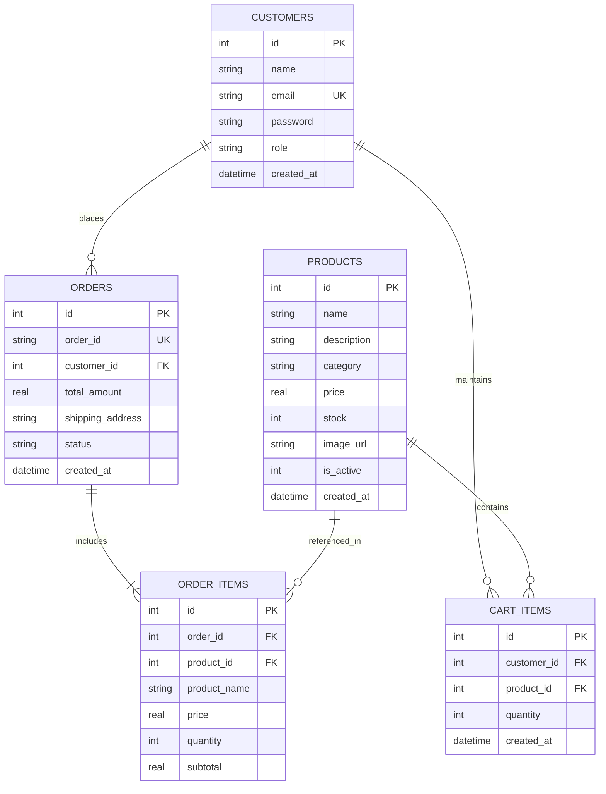

# ONLINE SHOPPING AND ORDER MANAGEMENT SYSTEM
## Comprehensive DevOps Laboratory Practical Manual & Technical Report

---

### 1. Project Title
**Online Shopping and Order Management System (Aura & Forma — Curated Artisanal Living)**

### 2. Problem Statement
Contemporary retail environments require resilient, responsive, and auditable digital transaction systems. Traditional monolithic applications frequently suffer from state inconsistencies during concurrent checkout operations, poor architectural separation, and fragile deployment lifecycles. Moreover, standard educational templates often lack commercial aesthetic identity, ACID-compliant transactional safety, and automated regression testing. 

This project solves these challenges by engineering a production-grade, full-stack e-commerce platform coupled with an automated Selenium WebDriver regression test harness, ACID-compliant SQLite transaction locking, and a complete container-ready DevOps lifecycle.

### 3. Project Objectives
1. **Full-Stack Implementation**: Develop a complete customer storefront and a separate, high-contrast administrative operations cockpit using Node.js, Express.js, and EJS.
2. **ACID Transaction Guarantee**: Implement atomic inventory reservation and checkout rollback mechanisms in SQLite to eliminate phantom orders and overselling.
3. **Distinctive Visual System**: Establish an original editorial brand identity ("Aura & Forma") utilizing warm terracotta, deep forest slate, and Scandinavian minimalist design tokens.
4. **End-to-End Test Automation**: Construct a 16-test Selenium WebDriver suite (Java 17, Maven, JUnit 5) verifying all 10 core modules.
5. **DevOps Readiness**: Ensure the application binds cleanly to `0.0.0.0:3000` with containerizable file structure, environment decoupling, and volume persistence preparation for future Docker and Jenkins integration.

---

### 4. Hardware & Software Requirements

#### Hardware Requirements
- **Processor**: Intel Core i3 / AMD Ryzen 3 or higher (x86_64 or ARM64)
- **RAM**: Minimum 4 GB (8 GB recommended for simultaneous browser automation and Docker Desktop)
- **Disk Space**: Minimum 2 GB free disk storage
- **Display Resolution**: 1366 &times; 768 minimum (1920 &times; 1080 recommended)

#### Software Requirements
- **Operating System**: Windows 10/11, macOS, or Linux
- **Runtime**: Node.js (v18.x to v24.x) & npm (v9.x to v11.x)
- **Java Development Kit**: OpenJDK 17 LTS (Temurin / Adoptium)
- **Build Tool**: Apache Maven (v3.8.x or v3.9.x)
- **Web Browser**: Google Chrome (v115+) & matching ChromeDriver (managed dynamically via Selenium Manager)
- **Database Engine**: SQLite 3 (native embedded driver `sqlite3`)
- **Code Editor**: Visual Studio Code or Cursor

---

### 5. Technology Stack Summary

| Layer | Technologies Used | Justification |
| :--- | :--- | :--- |
| **Frontend** | HTML5, CSS3 Variables, JavaScript (ES6+), EJS (Embedded JavaScript) | High performance server-side rendering, zero hydration overhead, SEO-friendly markup |
| **Backend** | Node.js, Express.js 5.x | Lightweight, event-driven I/O model, rapid route middleware chaining |
| **Database** | SQLite 3 (`sqlite3` driver) | Embedded, zero-configuration, file-based relational storage with full ACID compliance |
| **Security & Auth** | `express-session`, `bcryptjs` (salt rounds: 10) | State-safe cookie sessions, irreversible cryptographic password hashing |
| **Automation** | Java 17, Selenium WebDriver 4.25, JUnit 5.10, Maven 3.9 | Industrial standard test automation framework with explicit wait synchronization |
| **DevOps Baseline** | Git, GitHub, Jenkins Pipeline, Docker Containerization | Modern continuous integration and immutable container delivery pipeline |

---

### 6. Ten Functional Modules Breakdown

1. **Module 1: Customer Registration**: Full name, email format validation, minimum 6-character password check, duplicate email prevention, bcrypt password hashing, and immediate redirection to login with confirmation alert.
2. **Module 2: Customer Authentication & Session**: Secure credential verification against hashed SQLite records, session state management via HTTP-only cookies, automated role-based routing, and route protection middleware.
3. **Module 3: Product Catalogue**: Responsive grid presentation of curated artisan works, displaying high-resolution imagery, descriptive typography, live stock chips, category tags, and pricing.
4. **Module 4: Case-Insensitive Product Search & Filtering**: Multi-condition SQL queries (`LIKE %query%`), discipline pill filtering (Ceramics, Furniture, Lighting, Textiles, Fragrance), sorting selectors (Price, Alphabetical, Newest), and friendly fallback empty states.
5. **Module 5: Shopping Bag Management (Add to Cart)**: Session-bound cart persistence, stock availability verification, automatic item aggregation (upsert), and stock threshold guards.
6. **Module 6: Cart Quantity Adjustment**: Inline increment (`+`) and decrement (`-`) quantity controls, live subtotal computation, order total recalculation, and prevention of quantities exceeding active inventory.
7. **Module 7: Item Removal**: Individual item deletion from the cart table with atomic subtotal recalculation and dynamic empty bag notification.
8. **Module 8: ACID-Guaranteed Checkout**: Atomic database transaction (`BEGIN IMMEDIATE TRANSACTION`), server-side line-item recalculation, stock reservation and decrement (`UPDATE products SET stock = stock - ?`), unique order ID generation (`AF-XXXX-XXXXXX`), order and item logging, and complete cart cleanup with automatic rollback on error.
9. **Module 9: Customer Order History**: Strict customer isolation query (`SELECT * FROM orders WHERE customer_id = ?`), displaying historic order IDs, purchase timestamps, item breakdowns, unit prices, and grand totals.
10. **Module 10: Admin Operations & Cockpit**: Dedicated executive interface featuring real-time KPI counter cards (Total Products, Active Goods, Low Stock Alerts, Gross Revenue), modal product insertion, inline product updating, status toggling, and soft/hard product deletion.

---

### 7. Database Architecture & Entity Relationships

The relational model utilizes foreign key enforcement (`PRAGMA foreign_keys = ON;`) across five core entities:

---

### 8. Test Execution Verification Summary

#### A. Automated Node.js Functional Tests (18 Test Cases)
Executed via `npm test`:
- **FT01 to FT04**: Customer Registration, Duplicate Prevention, Invalid Login, Valid Session & Cookie &rarr; **ALL PASS**
- **FT05 to FT07**: Product Catalogue, Case-Insensitive Search, Non-Existent Search &rarr; **ALL PASS**
- **FT08 to FT11**: Add to Cart, Quantity Update, Stock Limit Guard, Item Removal &rarr; **ALL PASS**
- **FT12 to FT14**: Empty Cart Checkout Guard, Atomic Checkout Transaction & Stock Decrement, Order History &rarr; **ALL PASS**
- **FT15 to FT18**: Admin Login, Add Product, Update Product, Delete Product &rarr; **ALL PASS**
- **Result**: **18 Passed / 0 Failed (100% Success Rate)**

#### B. Selenium WebDriver Automation Tests (16 Test Cases)
Executed via `mvn -f selenium-tests/pom.xml test -DbaseUrl=http://localhost:3000`:
- **TC01**: Customer Login &rarr; **PASS**
- **TC02**: Product Search &rarr; **PASS**
- **TC03**: Add Product to Bag &rarr; **PASS**
- **TC04**: Update Bag Quantity &rarr; **PASS**
- **TC05**: Remove Product &rarr; **PASS**
- **TC06**: Simulated Checkout & Confirmation &rarr; **PASS**
- **TC07**: View Customer Order History &rarr; **PASS**
- **TC08**: Customer Registration &rarr; **PASS**
- **TC09**: Duplicate Registration Prevention &rarr; **PASS**
- **TC10**: Invalid Login Error Alert &rarr; **PASS**
- **TC11**: Admin Cockpit Authentication &rarr; **PASS**
- **TC12**: Add Product as Admin &rarr; **PASS**
- **TC13**: Update Product Specifications as Admin &rarr; **PASS**
- **TC14**: Delete Product as Admin &rarr; **PASS**
- **TC15**: Empty Bag Checkout Prevention &rarr; **PASS**
- **TC16**: Insufficient Stock Limit Guard &rarr; **PASS**
- **Result**: **16 Passed / 0 Failed / 0 Errors / 0 Skipped (BUILD SUCCESS)**
